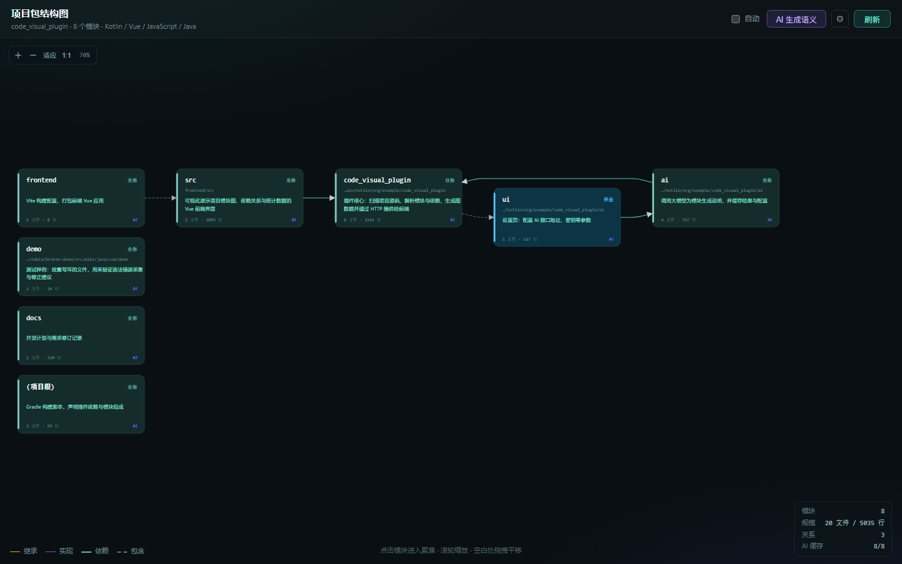
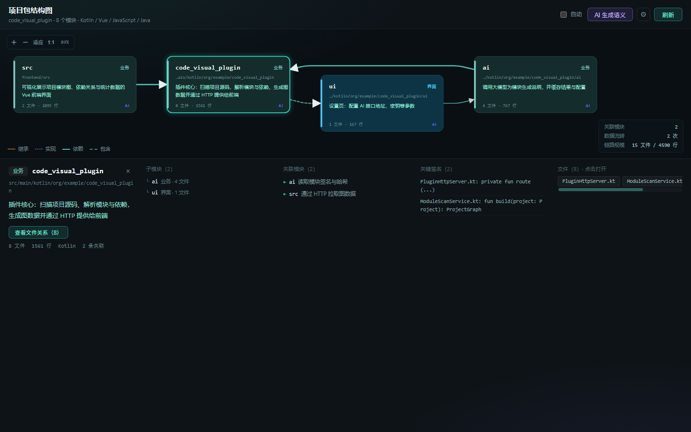
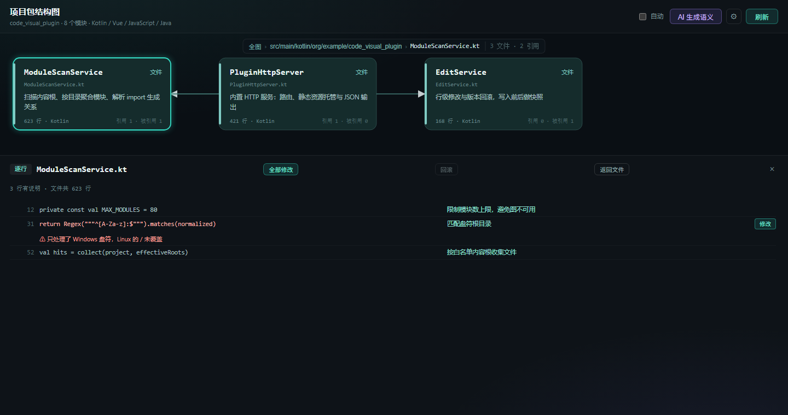

# CodeCanvas

把项目画成一张能点、能问、能改的模块关系图。

> IntelliJ IDEA 插件 · 语言无关 · 接入大模型

---

## 它解决什么

接手一个陌生项目时，目录结构和依赖关系散落在几十上百个文件里。
CodeCanvas 把它压缩成一张图：**一张卡片 = 一个目录**，卡片上写着它是做什么的，
卡片之间的线表示谁引用了谁。



## 三个层级

| 层级 | 你看到的 |
|---|---|
| 一级 | 全项目模块图，分层布局，一眼看清依赖走向 |
| 二级 | 点某个模块 → 只保留它和直接相关的模块，下方给出职责、子模块、关联、关键签名、文件清单 |
| 三级 | 进入模块 → 一排文件卡片，连线是文件级引用；点文件进入逐行解释 |



## 核心特性

- **语言无关**：不做语法解析，只按目录聚合 + 正则提取 import。
  支持 Java / Kotlin / JavaScript / TypeScript / Vue / Python / Go / Rust / C / C++。
- **AI 生成语义**：每个模块一句话说明它负责什么，按文件指纹缓存，源码不变不重复调用。
- **逐行解释**：把文件源码带行号发给模型，返回每行在做什么；有明显问题的行同时给出修正建议。
- **行级修改**：对可修的行一键改为建议内容；支持批量修改；每次修改前自动快照，最多回滚 3 版。
- **纯本地**：内置服务只绑定 127.0.0.1，代码只在你自己配置的模型接口上流转。



## 安装

1. 到 Releases 页面下载最新 `CodeCanvas-*.zip`
2. IDEA → `Settings → Plugins → ⚙ → Install Plugin from Disk...`
3. 选择刚下载的 zip，重启 IDE
4. 右侧边栏出现 **CodeCanvas** 工具窗

> 也可以手动解压到 `<IDE 配置目录>/plugins/` 下（解压后应有 `code_visual_plugin/lib/*.jar`）。

**环境要求**：IntelliJ IDEA 2024.2+（或任意基于 IntelliJ Platform 的 IDE），需要 JCEF。

## 使用

1. **配置模型**：`Settings → Tools → CodeCanvas AI`
   填 OpenAI 兼容的接口地址与 Key（例如 `https://api.deepseek.com/v1` + `deepseek-chat`）
2. **打开工具窗**：右侧 CodeCanvas，首次会自动扫描当前项目
3. **点模块**：进入二级视图，看职责与关联
4. **点「查看文件关系」**：进入三级，看文件之间的引用
5. **点文件 →「逐行解释」**：得到每行说明；可修的行右侧有「修改」按钮

快捷键：`Esc` 逐层返回，`Ctrl+F5` 刷新页面。

## 工作原理

```
项目源码 ──扫描──▶ 模块图(目录+引用+包含) ──HTTP──▶ Vue 前端(SVG + dagre) ──JCEF──▶ 工具窗
                          │
                          └──AI 语义（可选，带缓存）
```

插件用 Kotlin 实现，进程内嵌 Jetty 提供 JSON 接口并托管打包好的前端，
前端用 Vue 3 + dagre 做分层布局与连线路由，渲染在 IDE 的 JCEF 里。

## 接口一览

| 接口 | 用途 |
|---|---|
| `GET /api/projectGraph` | 模块图（命中缓存；`force=1` 强制重扫） |
| `GET /api/projectGraphVersion` | 版本号，前端据此决定是否重拉 |
| `GET /api/moduleFiles?moduleId=` | 模块内文件级引用图 |
| `GET/POST /api/explain?moduleId=&file=` | 逐行解释（异步任务） |
| `GET /api/explainStatus` | 任务状态与结果轮询 |
| `POST /api/applyFixes` | 行级修改 |
| `POST /api/rollback` | 回滚上一版 |
| `GET /api/open?moduleId=&file=` | 在编辑器中打开文件 |

## 已知限制

- 只扫描项目内容根之内的文件，跳过 `build/`、`node_modules/`、`.git/` 等目录
- 单次最多 4000 个文件 / 80 个模块，超出部分不展示
- 逐行解释只处理和发送前 220 行，控制 token 成本
- 回滚快照存于 `.idea/codecanvas/edits/`，仅保留最近 3 版
- AI 生成的内容（含修改建议）不保证正确，请用编辑器撤销或回滚兜底

## 开发

```bash
# 构建插件包（自动构建前端并打进 jar）
./gradlew buildPlugin

# 启动沙箱 IDE 调试
./gradlew runIde

# 前端单独开发（插件会探测 5173 并自动使用）
cd frontend && npm install && npm run dev
```

产物：`build/distributions/code_visual_plugin-<version>.zip`

## 许可

[MIT](LICENSE)
